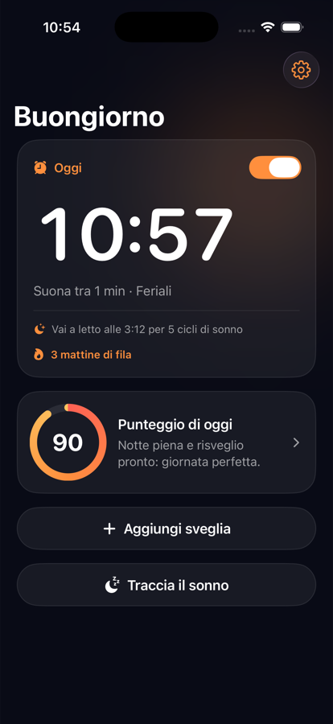
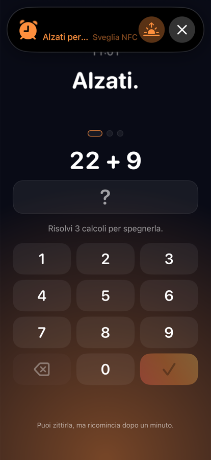
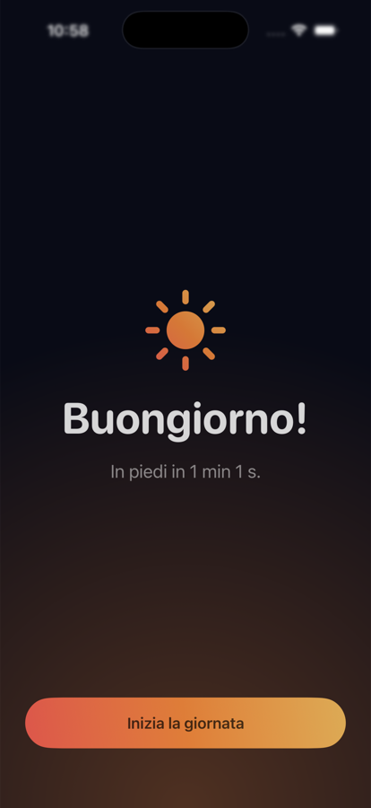
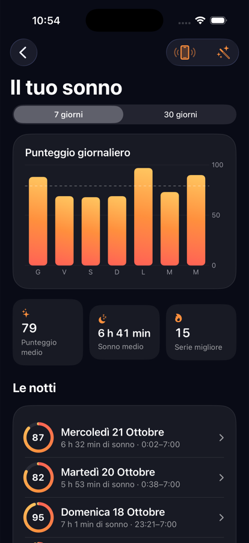

# Pantofole – Sveglia NFC

**La sveglia che per spegnerla devi alzarti.**
Suona finché non appoggi l'iPhone su un tag NFC lontano dal letto (o risolvi una missione di matematica). Niente posticipo, niente account, nessun dato che lascia il telefono.

*English summary at the bottom.*

<p align="center">
  
  
  
  
</p>

## Cosa fa

- **Si spegne solo col tag.** Abbini un qualsiasi tag NFC (NTAG213/215/216, costa pochi centesimi) o il dischetto stampato in 3D di questo progetto, lo metti in bagno o in cucina, e la sveglia si ferma solo quando ci appoggi sopra l'iPhone.
- **Oppure con una missione.** In alternativa al tag: 3 calcoli, uno più difficile dell'altro (Facile, Media, Difficile). Senza un tag abbinato è il metodo predefinito, così l'app funziona anche senza hardware.
- **Niente posticipo.** Se la zittisci con il tasto Ferma o con i tasti del volume, dopo un minuto ricomincia. Dopo 30 minuti si ferma da sola: è l'uscita di emergenza se il tag si rompe o si perde.
- **Niente scappatoie la sera prima.** Nelle 8 ore prima di una sveglia non puoi spostarla né spegnerla senza il tag.
- **32 suonerie originali**, da dolci a energiche, più la possibilità di usare una tua canzone (da File o dalla libreria Musica).
- **Ascolto del sonno sul comodino.** Durata, qualità, russamento, risvegli e una stima delle fasi. L'audio viene analizzato in memoria sul telefono e **mai registrato, salvato o inviato**.
- **Punteggio di oggi.** Un numero da 0 a 100 che unisce la qualità del sonno e quanto in fretta ti sei alzato, con storico a 7 e 30 giorni.
- **Blocco delle app.** Scegli app e orari (es. 23:00–7:00): restano in pausa con Tempo di utilizzo e si sbloccano prima solo scansionando il tag.
- **Pensata per la notte.** Tema scuro, una sola azione principale per schermata, aptica, VoiceOver e Dynamic Type.

## Come funziona dentro

iOS non permette a un'app di bloccare il tasto Ferma, i tasti del volume o la chiusura dell'app. Per questo la sveglia usa [AlarmKit](https://developer.apple.com/documentation/alarmkit) (iOS 26) in due livelli:

1. **La testa**: una sveglia di sistema ripetuta all'ora scelta. Suona anche con l'iPhone bloccato, in silenzioso o in Full immersion, e anche se l'app non viene più aperta.
2. **La catena**: sveglie singole ogni 60 secondi per 30 minuti, registrate in anticipo per la mattina in corso e le due successive. Zittire uno squillo non cancella i successivi; solo il tag (o la missione) cancella il resto della catena.

La logica pura (orari, catena, blocco delle modifiche, missioni, analisi del sonno, punteggi, finestre dei blocchi) sta nel pacchetto Swift `Packages/SvegliaCore`, senza dipendenze da UIKit o AlarmKit, ed è coperta da test.

```
SvegliaNFC/                 app iOS (SwiftUI, SwiftData)
├── Alarm/                  AlarmKit: testa + catena, intent del pulsante sulla sveglia
├── NFC/                    lettura (e scrittura opzionale) dei tag con Core NFC
├── Sleep/  Views/Sleep/    ascolto del sonno e schermate
├── Sounds/ Resources/      catalogo e file delle suonerie
├── Blocks/                 blocco app con Tempo di utilizzo
├── Views/  Design/         interfaccia
BlockShared/ BlockMonitor/ BlockShield/   codice condiviso ed estensioni del blocco app
Packages/SvegliaCore/       logica pura + test (swift test)
hardware/                   dischetto 3D per il tag (STL, OpenSCAD, istruzioni)
tools/genera_suonerie.py    generatore delle suonerie
Config/                     Info.plist ed entitlements
```

## Compilare e provare

Servono **Xcode 26.3** o successivo e un iPhone con **iOS 26.1** o successivo (per l'NFC: iPhone XS o successivo).

```bash
cd Packages/SvegliaCore && swift test
```

```bash
xcodebuild -project SvegliaNFC.xcodeproj -scheme SvegliaNFC -destination 'platform=iOS Simulator,name=iPhone 17 Pro' CODE_SIGNING_ALLOWED=NO build
```

**Nel simulatore** l'NFC non esiste: ogni scansione restituisce un tag finto ("SIMULATORE"), così si possono provare tutti i flussi. La sveglia usa il suono standard, perché nel simulatore di iOS 26.2 una suoneria personalizzata di AlarmKit fa cadere SpringBoard (sugli iPhone veri no). Per vedere storico e punteggi con dati di esempio, avvia l'app con l'argomento `-seedSleepData` (solo nelle build Debug).

**Su un iPhone vero** serve l'Apple Developer Program, perché le capability *NFC Tag Reading*, *App Groups* e *Family Controls* non sono disponibili con l'account gratuito. In Xcode, per i target `SvegliaNFC`, `BlockMonitor` e `BlockShield`:

1. scegli il tuo Team in *Signing & Capabilities*;
2. sostituisci `com.sveglianfc.app` con un bundle identifier tuo (anche nelle estensioni: `.monitor`, `.shield`);
3. sostituisci l'App Group `group.com.sveglianfc.app` con uno tuo (anche in `BlockShared/AppBlock.swift`).

Per pubblicare sull'App Store il blocco app richiede anche l'entitlement *Family Controls (Distribution)*, da chiedere ad Apple per ogni bundle identifier.

## Il dischetto 3D

Nella cartella [`hardware/`](hardware/) c'è un dischetto da Ø 55 mm con il tag sigillato dentro durante la stampa: STL pronti, sorgente OpenSCAD con le misure modificabili, uno script che rigenera gli STL e le istruzioni per Bambu Studio (pausa al layer 25 per inserire il tag). Funziona anche qualsiasi tag NFC già pronto, purché non sia appoggiato su metallo.

## Privacy

- Nessun account e nessun server: sveglie, tag, notti e punteggi restano sull'iPhone (SwiftData).
- Il microfono serve solo durante l'ascolto del sonno, che avvii tu. L'audio è analizzato in memoria con il classificatore di suoni di Apple sul dispositivo; si salvano solo numeri al minuto.
- Il blocco app usa Tempo di utilizzo: l'app non sa quali app hai scelto, le gestisce iOS.

## Limiti noti

- Una suoneria personalizzata di AlarmKit dura al massimo circa 30 secondi e non va in loop: tra uno squillo della catena e il successivo può esserci silenzio.
- Le canzoni importate in `Library/Sounds` dipendono da un problema noto di AlarmKit su alcune versioni di iOS 26.
- Le soglie dell'analisi del sonno sono calibrate su dati sintetici: è una stima, non uno strumento medico.
- iOS consente circa 20 pianificazioni di Tempo di utilizzo per app; un blocco con giorni specifici ne usa una per giorno.
- Testi solo in italiano per ora.

## Contribuire

Segnalazioni e pull request sono benvenute. Prima di inviare: `swift test` nel pacchetto `SvegliaCore` deve passare e l'app deve compilare per simulatore e dispositivo.

## Licenza

[MIT](LICENSE). Le suonerie sono generate da `tools/genera_suonerie.py` e sono coperte dalla stessa licenza.

---

## English summary

**Pantofole** is an iPhone alarm clock you can only switch off by getting out of bed: it keeps ringing until you tap your phone on an NFC tag placed in another room (or solve a math mission). No snooze; silencing it with the Stop button or the volume keys only buys you a minute, and after 30 minutes it stops on its own as an emergency exit. It also includes 32 original ringtones, on-device sleep tracking (audio is never recorded or uploaded), a daily score, and Screen Time app blocking that only the tag can lift early. No accounts, no servers.

Built with SwiftUI, SwiftData, AlarmKit, Core NFC, SoundAnalysis and the Screen Time APIs; requires iOS 26.1. The `hardware/` folder contains a 3D-printable puck that seals the NFC tag inside. Licensed under MIT.
