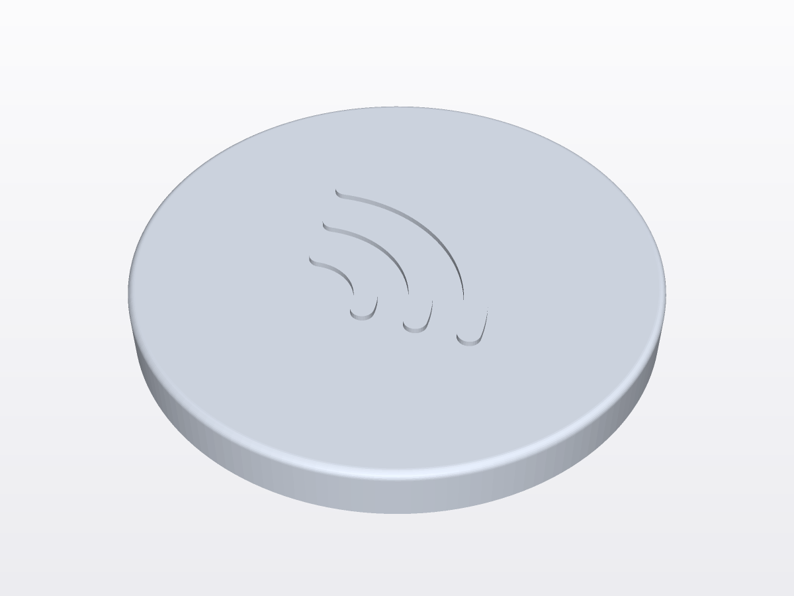
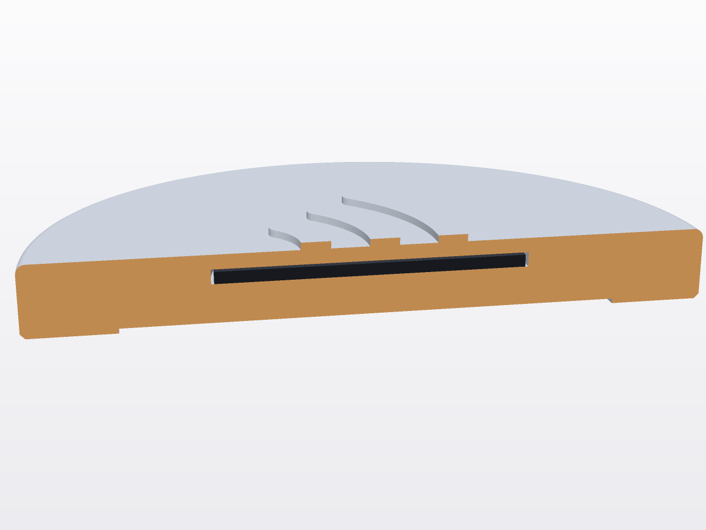

# Dischetto NFC per SvegliaNFC

Un dischetto di PLA (Ø 55 mm, alto 6 mm) con un tag NFC **sigillato dentro**.
Lo tieni in un'altra stanza: per spegnere la sveglia devi alzarti e appoggiarci sopra l'iPhone.
Il tag si inserisce **durante la stampa**: la stampante fa una pausa, metti il tag nella cavità, e la stampa riprende chiudendolo dentro.

## File

| File | A cosa serve |
|---|---|
| `dischetto.stl` | Il pezzo da stampare |
| `provino.stl` | Quadratino 32×32×4 mm: test di ~10 minuti per controllare tag e lettura |
| `dischetto.scad` | Sorgente con tutte le misure modificabili (OpenSCAD) |
| `genera_stl.py` | Rigenera i due STL **senza OpenSCAD**, leggendo le misure da `dischetto.scad` |
| `anteprima.png`, `anteprima-sezione.png` | Immagini di controllo |

## Cosa comprare

- **Tag NFC NTAG213 o NTAG215, rotondi da ~25 mm** (tipo "moneta" in PVC o adesivi). L'iPhone li legge senza problemi.
  - **Evita i MIFARE Classic** (es. "S50", "1K"): l'iPhone non li legge come dovrebbe.
  - **Evita i tag "anti-metal" / "on-metal"** (hanno uno strato di ferrite e sono più spessi), a meno che il dischetto debba stare su una superficie di metallo: in quel caso servono proprio quelli, e devi aggiornare lo spessore (vedi in fondo).
- **Filamento: PLA normale** (va bene anche opaco o silk). È facile da stampare, rigido e non ferma le onde radio.
  **NON usare** filamenti caricati carbonio (PLA-CF), caricati metallo (bronzo, rame, acciaio) o conduttivi: schermano l'NFC.
- **Biadesivo**: un tondino da ~40 mm (o un pezzo ritagliato), oppure un gommino antiscivolo.
- Consigliato: un **calibro** per misurare il tag.

> **Misura il tag appena arriva** (diametro e spessore, adesivo compreso). Le misure di default sono Ø 25 mm × 1,0 mm. Se sono diverse, cambiale prima di stampare (vedi "Cambiare le misure").

## I numeri da sapere (misure di default)

| | Dischetto | Provino |
|---|---|---|
| Misure esterne | Ø 55 × 6,6 mm (6,0 + 0,6 di icona) | 32 × 32 × 4 mm |
| Cavità del tag | Ø 25,5 mm, profonda 1,2 mm, **da Z 3,6 a Z 4,8 mm** | uguale, da Z 1,6 a Z 2,8 mm |
| Plastica sopra il tag | 1,2 mm (6 layer) | 1,2 mm |
| Plastica sotto il tag | 3,2 mm (sopra l'incavo per il biadesivo) | 1,6 mm |
| Ultimo layer con la cavità aperta | layer 24 (finisce a Z 4,80) | layer 14 (Z 2,80) |
| **PAUSA in Bambu Studio** | **layer 25 (Z 5,00 mm)** | **layer 15 (Z 3,00 mm)** |
| Cambio colore per l'icona (facoltativo) | layer 31 (Z 6,20 mm) | — |
| Layer totali | 33 | 20 |
| Filamento (stima) | ~8–9 g a dischetto con 15–20 % di riempimento (16,4 g se fosse pieno) | ~3 g |
| Tempo (stima) | ~20 min un dischetto da solo; ~3,5–4,5 ore per un piatto da 16 | ~10–15 min |

Regola: con layer da 0,2 mm (primo layer compreso) **il layer n finisce a Z = 0,2 × n**.
Bambu Studio fa la pausa **prima** di stampare il layer selezionato: selezioni il 25, si ferma dopo aver finito il 24, quando la cavità è ancora aperta.
Grammi e tempi sono stime: dopo lo slicing Bambu Studio mostra i valori esatti.

## Prima stampa il provino (consigliato)

Stampa `provino.stl` da solo, con la stessa procedura qui sotto ma con la **pausa al layer 15 (Z 3,00)**.
Ti serve per verificare che il tag entri piatto e che l'iPhone lo legga attraverso 1,2 mm di plastica.
Non mettere provino e dischetti sullo stesso piatto: hanno la pausa a layer diversi.

## Stampa in Bambu Studio (Bambu Lab A1)

1. **Stampante e materiale**: stampante "Bambu Lab A1", ugello 0,4. Filamento PLA (es. "Bambu PLA Basic").
2. **Importa**: File → Importa → `dischetto.stl` (o trascina il file nella finestra). Il pezzo è già nel verso giusto (icona in alto): non girarlo.
3. **Profilo di stampa**: "0.20mm Standard @BBL A1". Controlla:
   - Qualità: altezza layer **0,2**, altezza primo layer **0,2**. Lascia **spenta** l'altezza layer variabile/adattiva.
   - Resistenza: **3 pareti** (Wall loops = 3), riempimento (Sparse infill density) **15–20 %**.
   - Supporti: spenti.
4. **Tanti dischetti in una volta** (una sola pausa per tutti): seleziona il dischetto, tasto destro → "Imposta numero di istanze" ("Set number of instances") → **16**, poi "Disponi" ("Arrange", tasto **A**). 16 dischetti dovrebbero stare sul piatto in una griglia 4×4 (se "Disponi" non ci riesce, usane qualcuno in meno).
   Lascia la sequenza di stampa "per layer" (è quella standard), non "per oggetto".
5. **Slicing**: premi "Elabora piatto" ("Slice plate") e vai nella scheda **Anteprima** ("Preview").
6. **Aggiungi la pausa**: trascina il cursore verticale a destra fino al **layer 25 (5.00)**.
   Controllo: al layer 24 (4.80) vedi ancora i buchi tondi aperti, al 25 sono coperti.
   Fai clic destro sul **"+"** accanto al cursore → **"Aggiungi pausa"** ("Add Pause"). Compare un segno su quel layer.
7. **Icona di un altro colore (facoltativo)**: cursore al **layer 31 (6.20)** → clic destro sul "+" → "Add color change" / "Cambia filamento".
   Con l'AMS lite cambia da sola. **Senza AMS lite** metti invece una seconda **pausa** al layer 31 e cambia il filo a mano dallo schermo della stampante (Filamento → Scarica, poi Carica), poi riprendi.
8. **Invia** il piatto alla stampante ("Stampa piatto" / "Print plate").

## Durante la pausa

L'A1 si ferma, sposta la testina di lato e aspetta. Il piatto resta caldo: non toccarne la superficie.

1. **Prova ogni tag con il telefono prima di inserirlo** (con l'app SvegliaNFC o un'app gratuita come "NFC Tools"). Meglio ancora se li provi tutti prima di avviare la stampa, così la pausa dura poco.
2. **Metti il tag nella cavità**, ben piatto: togli la pellicola e attaccalo con il suo adesivo, oppure con un puntino minuscolo di colla (senza grumi).
3. **Controlla che non sporga**: il tag deve stare sotto il bordo della cavità (c'è 0,2 mm di margine). Niente angoli sollevati, pellicole o fili di plastica nel buco. Se qualcosa sporge, l'ugello lo urta.
4. Non spostare i pezzi e non premere forte, potrebbero staccarsi dal piatto.
5. **Riprendi** dallo schermo della stampante ("Riprendi" / "Resume") o dall'app **Bambu Handy**.
   Non lasciare la stampante in pausa per ore: bastano pochi minuti.

## Dopo la stampa

- Lascia raffreddare e stacca i dischetti. Prova la lettura: appoggia sul dischetto **la parte alta dell'iPhone** (vicino alle fotocamere, dove c'è l'antenna NFC).
- Attacca il biadesivo nell'incavo sotto.

## Dove metterlo

- **Lontano dal letto**, in un'altra stanza: è il punto di tutto.
- **Non su superfici di metallo** (frigorifero, mensole o termosifoni di metallo): il metallo blocca l'NFC. Se proprio devi, usa tag "on-metal" e ristampa con il loro spessore.
- Su una superficie piana, fissato con il biadesivo.
- Cover molto spesse o accessori MagSafe con piastre di metallo (portafogli, anelli) possono disturbare la lettura.

## Cambiare le misure

1. Misura il tag col calibro: diametro e spessore (adesivo compreso).
2. Apri `dischetto.scad` con un editor di testo e cambia `tag_d` (diametro) e `tag_t` (spessore). Gli altri numeri hanno un commento che li spiega.
3. Rigenera gli STL, in uno dei due modi:
   - **Senza installare nulla**: nel Terminale vai nella cartella `hardware` e scrivi `python3 genera_stl.py`.
     Riscrive `dischetto.stl` e `provino.stl`, controlla che siano chiusi e stampa i layer della pausa e del cambio colore.
   - **Con OpenSCAD** (da openscad.org; al momento il pacchetto Homebrew è disattivato): apri `dischetto.scad`, menu Finestra → Customizer, cambia i valori, premi **F6** (Render), poi File → Esporta → STL.
     Per il provino metti `pezzo = "provino"`. La console di OpenSCAD scrive il layer della pausa.
4. **Ricontrolla il layer della pausa** nel messaggio stampato (e nell'anteprima di Bambu Studio).

Buono a sapersi:

- La profondità della cavità viene arrotondata in su a un multiplo di 0,2 mm (tag 1,0 → cavità 1,2; tag 1,2 → cavità 1,4).
  Il soffitto della cavità resta a Z 4,8, quindi **la pausa resta al layer 25** finché non cambi `disco_h` o `copertura`.
- Con un tag più spesso di ~2,6 mm lo script si ferma con un errore: aumenta `disco_h` (sempre a passi di 0,2).
- Il provino invece si alza da solo se il tag è spesso, quindi **la sua pausa può cambiare**: usa il layer scritto dallo script.
- `incavo_adesivo = false` toglie l'incavo sotto. `icona = false` toglie l'icona.
- Mantieni layer da 0,2 mm, primo layer compreso: tutte le quote sono calcolate su quello.
